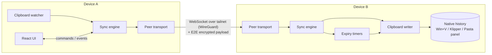

# Pasta architecture

Pasta syncs copied text between your own machines over Tailscale and, on macOS,
replaces Paste.app with a native clipboard history panel.

- **Copy on one device → appears in every other device's native clipboard history**
  (Win+V on Windows, Klipper on KDE Plasma, Pasta's own panel on macOS).
- **Traffic never leaves the tailnet**, and payloads are end-to-end encrypted with a
  key only your devices hold.
- **Each device has its own mode** (send / receive / both / paused) and **expiry timer**
  (5 s → never) for items it receives.

Approved mocks: <https://claude.ai/artifact/SxDCzg1FQZJU2YckgvEcAp> ·
Roadmap: issue #65 · Decisions: [`docs/adr/`](adr/README.md)

## Scope of v1

| In                                            | Later                                    |
| --------------------------------------------- | ---------------------------------------- |
| Text: plain plus HTML / RTF flavors           | Images (#61)                             |
| Live sync between online devices              | Offline catch-up (#62)                   |
| macOS, Windows, KDE Plasma (CachyOS)          | GNOME (#60), mobile (#63)                |
| Mac panel: search, rich text, source-app icon | Pinboards, quick paste, Quick Look (#64) |

## Process model

Pasta is one Tauri 2 app per device that runs in the background (tray / menu bar).
**Rust does all the work**: watching and writing the clipboard, networking, crypto,
storage, global shortcuts and native panels. **React is only the UI**, talking to Rust
through typed Tauri commands and events.



Every device is both server and client: each listens on its tailnet address only and
connects out to the peers it discovers. There is no central server.

## Crates

```
crates/
  pasta-core       domain model, wire protocol, sync engine, adapter traits (no I/O)
  pasta-crypto     sync-chain phrase + key derivation, AEAD, device keys, protected memory
  pasta-net        Tailscale client (discovery, WhoIs), WebSocket transport, connection manager,
                   and `Node`, which wires the engine to the network
  pasta-clipboard  per-OS clipboard adapters: watch / write / expire
src-tauri/         the app: wiring, Tauri commands/events, windows, tray, plugins
src/               React UI
```

Dependency direction: `pasta-core` ← `pasta-crypto` ← `pasta-net` / `pasta-clipboard` ←
`src-tauri`. `pasta-core` stays free of OS, network and Tauri code so the engine can be
tested with fake adapters (`pasta_core::testing`). The integration tests (#19) run real
`Node`s on loopback with fake clipboards and a static discovery list instead of Tailscale.

## Data flow: one copy

1. **Watch.** The platform watcher sees a new clipboard item, skips it if it's marked
   sensitive, comes from an excluded app, or was written by Pasta itself.
2. **Engine.** Builds a `clip` message (item id, origin device, source app, timestamp,
   flavors, content hash), debounces and dedupes it.
3. **Encrypt + send.** The payload is sealed with the chain key (#21) and sent to every
   connected, approved peer whose mode accepts it.
4. **Receive.** The peer verifies the sender (Tailscale WhoIs + chain membership),
   decrypts, checks the content hash against recently seen items (no ping-pong) and
   hands it to its clipboard writer.
5. **Write.** The writer puts the item on the clipboard so it lands in native history,
   tagged so the local watcher ignores it.
6. **Expire.** The receiving device starts a timer from its own TTL. When it fires, the
   platform adapter deletes that history entry (and clears the clipboard if the item is
   still current).

## Networking and trust

- **Discovery and identity** come from the local Tailscale client via its CLI's `--json`
  output ([ADR 0002](adr/0002-tailscale-access.md)).
- **Transport** is WebSocket bound to the tailnet interface only (100.64.0.0/10,
  fd7a:115c:a1e0::/48), never 0.0.0.0 ([ADR 0003](adr/0003-transport-and-encryption.md)).
- **Trust has three layers**: WireGuard (Tailscale) on the wire; a 24-word _sync chain_
  whose derived key encrypts every payload; and a one-time _approval_ of each new
  device by an existing member. A tailnet may contain other people's and tagged
  devices, so "being on the tailnet" alone never grants anything.

## Wire protocol (v1)

One JSON envelope per WebSocket text frame, defined in `pasta_core::protocol`
([ADR 0006](adr/0006-protocol-and-sync.md)):

```json
{
  "v": 1,
  "type": "clip",
  "msg_id": "9b1c…",
  "from_device": "3f2a…",
  "sent_at": 1730000000000,
  "body": {
    "item_id": "c0de…",
    "origin_device": "3f2a…",
    "origin_app": { "name": "Safari", "id": "com.apple.Safari" },
    "created_at": 1730000000000,
    "flavors": { "text/plain": "…", "text/html": "…" },
    "content_hash": "<sha-256 of the plain text, hex>"
  }
}
```

| Type        | Body                                                                         | Sent                                         |
| ----------- | ---------------------------------------------------------------------------- | -------------------------------------------- |
| `hello`     | device id, name, OS, OS version, app version, protocol version, capabilities | by the dialer, first                         |
| `hello_ack` | same as `hello`                                                              | by the listener, once accepted               |
| `clip`      | one copied item; `text/plain` required, `text/html` / `text/rtf` optional    | on every local copy                          |
| `ack`       | `msg_id` of the `clip`                                                       | on receiving a `clip`                        |
| `ping`      | empty                                                                        | every 10 s                                   |
| `pong`      | `ping_id`                                                                    | in reply; gives the latency                  |
| reserved    | `config_update` (#31), `device_approval` (#22), `encrypted` (#21)            | not yet; ignored like any other unknown type |

- **Versioning:** `v` is the major version. A peer with another one is refused with
  close code 4001; unknown message types within v1 are ignored.
- **Limits:** 1 MiB per item by default (`max_item_bytes` in the config). Too-big items
  lose RTF, then HTML, before they're refused. Receivers check size and `content_hash`.
- **Close codes:** 4001 version, 4002 refused (not a tailnet node, or a device id seen on
  another node), 4003 duplicate connection, 4004 protocol error, 4005 heartbeat timeout.
- **Echo prevention:** the engine never broadcasts a copy whose hash matches the item it
  believes is current, and never relays an item from a peer.

## Platform matrix

|                | macOS                                                                                                                                                                                        | Windows                                                                                                            | KDE Plasma 6                                                        |
| -------------- | -------------------------------------------------------------------------------------------------------------------------------------------------------------------------------------------- | ------------------------------------------------------------------------------------------------------------------ | ------------------------------------------------------------------- |
| Watch          | Poll `NSPasteboard.changeCount` (~250 ms)                                                                                                                                                    | `AddClipboardFormatListener` / `WM_CLIPBOARDUPDATE`                                                                | data-control protocol or Klipper D-Bus (spike #49)                  |
| Write          | `NSPasteboard` + Pasta marker type                                                                                                                                                           | Clipboard write that lands in Win+V ([ADR 0004](adr/0004-windows-clipboard-history.md))                            | data-control / Klipper (spike #49)                                  |
| Native history | Pasta's own panel (⇧⌘V)                                                                                                                                                                      | Win+V                                                                                                              | Klipper                                                             |
| Expire         | Pasta store; clear pasteboard if still ours                                                                                                                                                  | `Clipboard.DeleteItemFromHistory`                                                                                  | TBD by spike #49                                                    |
| Skip sensitive | `org.nspasteboard.ConcealedType` / `TransientType` / `AutoGeneratedType`, plus a default list of password-manager apps and browser extensions (not every manager sets the markers; ADR 0005) | `ExcludeClipboardContentFromMonitorProcessing`, `CanIncludeInClipboardHistory = 0`, plus the same default app list | `x-kde-passwordManagerHint: secret`, plus the same default app list |
| Secrets        | Keychain                                                                                                                                                                                     | Credential Manager / DPAPI                                                                                         | KWallet / Secret Service                                            |
| Tailscale CLI  | `/Applications/Tailscale.app/Contents/MacOS/Tailscale`                                                                                                                                       | `C:\Program Files\Tailscale\tailscale.exe`                                                                         | `/usr/bin/tailscale` (needs `--operator`)                           |
| iCloud bridge  | Universal Clipboard via the general pasteboard ([ADR 0005](adr/0005-macos-pasteboard.md))                                                                                                    | n/a                                                                                                                | n/a                                                                 |

## Frontend

```
src/
  windows/   one component tree per Tauri window (settings, onboarding, panel, tray popover)
  ipc/       typed wrappers around Tauri commands and events; mirrors Rust types
  (later)    components/, platform/ (per-OS theme tokens: macOS, Fluent, Breeze), state/
```

The UI follows each OS's native look (see the mocks). Rust types exposed over IPC are
mirrored in `src/ipc/`; generating them from Rust is planned in #28.

## Where things are tracked

| Milestone                   | Issues  |
| --------------------------- | ------- |
| M0 · Foundations            | #1–#6   |
| M1 · Mac ↔ Windows sync MVP | #7–#19  |
| M2 · Trust & encryption     | #20–#27 |
| M3 · Full client            | #28–#48 |
| M4 · KDE Plasma client      | #49–#55 |
| M5 · Release & distribution | #56–#59 |
| Later                       | #60–#64 |

See [`docs/development.md`](development.md) for setting up a dev machine.
